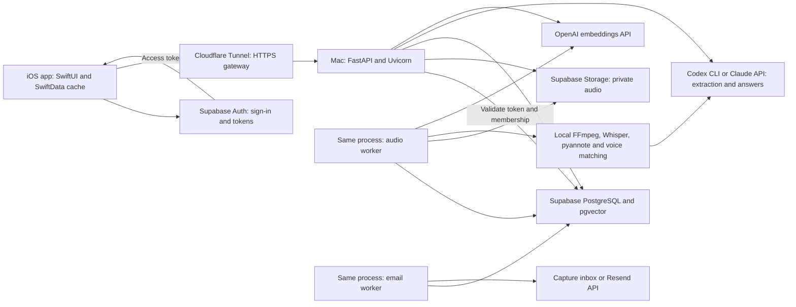
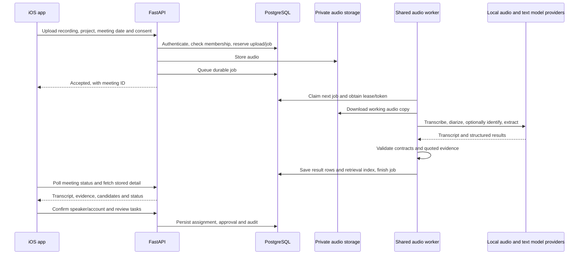
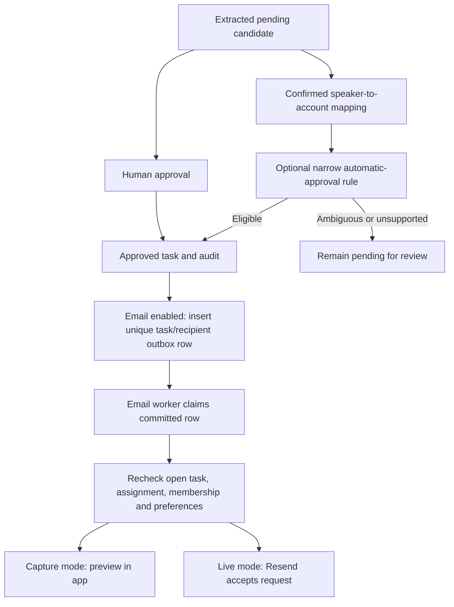

# Current application architecture

Updated October 17, 2026. This describes the current code, including immediate
follow-up email. It is a navigation and troubleshooting guide, not evidence that
every path has passed native or model-quality acceptance. See the
[Milestone 4 roadmap](milestone_4/roadmap.md) for remaining validation.

## 1. System shape

LabSync is a native iOS client backed by a Python application. Supabase provides
identity, PostgreSQL, and shared audio storage. A Mac runs the API and processing
workers; Cloudflare Tunnel makes that API reachable from the phone. Model services
perform text extraction, answers, and embeddings. Audio inference runs locally.



The workers are threads in the backend process, not separately deployed services.
Audio processing launches subprocesses. Another shared-mode backend can run on a
second Mac against the same database/storage. That supports job recovery, but
provides no automatic routing to a healthy API and no guarantee a laptop stays awake.

## 2. Technology and responsibility

| Layer | Current technology | Owns | Start reading |
| --- | --- | --- | --- |
| Native presentation | SwiftUI | Meetings, Tasks, Chat, Profile, review sheets | `ios/MeetingApp/MeetingApp/RootTabView.swift`, `Views/` |
| App state and navigation | SwiftData, observable session/navigator | Cached records, signed-in stage, screen selection | `Models/`, `Auth/AppSession.swift`, `Navigation/MeetingNavigator.swift` |
| Client networking | URLSession | Authenticated uploads, reads, edits, polling, SSE | `Networking/MeetingAPIClient.swift` |
| Audio and OS integration | AVPlayer, EventKit | Local playback/seek and one-time Reminders export | `Views/Meetings/Detail/AudioDockView.swift`, `Networking/ReminderScheduler.swift` |
| API | FastAPI, Uvicorn, Pydantic | HTTP boundary, validation, access checks | `src/labsync/server.py`, `api/` |
| Database access | psycopg and connection pool | SQL, persistence, transactions | `src/labsync/db/` |
| Shared processing | PostgreSQL job claims, Python threads/subprocesses | Durable queue, leases, retries, publication | `shared_backend.py`, `shared_jobs.py`, `pipeline.py` |
| Audio inference | FFmpeg, Whisper via MLX or local OpenAI Whisper implementation, pyannote | Decode, transcribe, separate speakers | `ccb.py`, `voice.py`, external transcriber |
| Text generation | Codex CLI or Claude API | Structured extraction and grounded answers | `providers.py`, `codex_client.py`, `claude_client.py` |
| Search | OpenAI text embeddings, pgvector, PostgreSQL full-text search | Dense/sparse retrieval and fusion | `embeddings.py`, `chunking.py`, `db/rag.py` |
| Follow-through | PostgreSQL outbox, email worker, optional Resend | Immediate task email and retry history | `followup.py`, `api/followup.py` |
| Verification | Pytest, Ruff, Xcode build/tests | Contracts, integration checks, regression protection | `tests/`, `.github/workflows/ci.yml`, `ios/MeetingApp/MeetingAppTests/` |

Python requires 3.12+ according to `pyproject.toml`. Dependency versions belong in
`pyproject.toml`/`uv.lock`; model defaults belong in `providers.py` and
`embeddings.py`. Runtime flags and saved job settings determine the actual model
used, so a README model name is not execution evidence. The current development
backend was launched with MLX Whisper `base`, not the old README's `medium` claim.

## 3. Where the data lives

| Data | Authoritative location | Other copies and caveats |
| --- | --- | --- |
| Identity and sign-in | Supabase Auth | iOS Supabase SDK manages the session; backend verifies tokens |
| Projects and membership | PostgreSQL `projects`, `profiles`, `project_members`, invitations | SwiftData caches display state; cache visibility is not proof of a live backend |
| Meeting content | PostgreSQL `meetings`, `meeting_transcripts`, summaries, decisions | Worker snapshots also contain transcript/extraction representations |
| Tasks and their state | PostgreSQL `tasks`, `item_evidence`, `task_audit_log` | Separate pending candidate and accepted-task models exist on the phone |
| Audio in shared mode | Private Supabase Storage bucket | Processing uses local working copies; playback downloads a temporary local file |
| Processing ownership/status | PostgreSQL `meeting_jobs` and `meetings` in shared mode | Saved JSON record/settings in each job support polling and reproducibility |
| Search index | PostgreSQL `rag_chunks` plus task title embeddings | Derived from meeting/task data; not a separate authoritative task store |
| Conversations | PostgreSQL chat conversation/message tables | Stored by user and scope; citation sources come from project records |
| Email attempts and capture previews | PostgreSQL `task_followup_emails` | A provider-accepted message cannot be recalled by deleting its database record |
| Evaluation files | Versioned fixtures and documented outputs; local `artifacts/` for run products | Seeded UI tests, natural audio, and model accuracy results are different evidence |

Shared mode does not use the phone as a write authority. Client updates go through
the API before being applied to cached server records. Some development/preview
paths support non-server IDs locally; do not confuse those with a shared project.

Database changes are versioned in `supabase/migrations/`. `db/schema.sql` is a
historical initial schema, not the complete current schema. Read the migrations
in order or inspect a migrated disposable database when reviewing the data model.

## 4. Sign-in and authorization

1. `Auth/AppSession.swift` and the Supabase SDK handle sign-in and onboarding.
2. `MeetingAPIClient` sends a bearer access token with backend requests.
3. `auth.py` verifies the token. `api/deps.py` loads the current profile and checks
   onboarding. The backend does not trust a client-supplied user ID as identity.
4. Project, meeting, and task routes check membership through `db/access.py` and
   dependencies. Inaccessible project data usually returns 404 to outsiders.
5. The backend uses a privileged database connection. Tables use RLS and restricted
   grants; this does not replace the API's membership checks because its connection
   can access records that ordinary client roles cannot.
6. Shared audio is private. The backend checks membership before producing a
   short-lived signed audio URL. Privileged storage credentials stay server-side.

Cloudflare exposes the API; it does not replace application authentication.
A user needs an app account and project membership, not Supabase dashboard/team
membership just to use the app. Provider-specific Google test-user restrictions
may still affect sign-in during development.

## 5. Recording to reviewed tasks



Detailed code trail:

1. `Views/Meetings/AddMeetingSheet.swift` collects title, selected date, file, and
   consent. Meeting date currently comes from the upload form, not reliable
   automatic recording-date inference.
2. `MeetingAPIClient.upload` calls `/api/v1/meetings/upload`. Shared-mode upload
   lives in `shared_backend.py`; the local-mode implementation is in `server.py`.
3. `shared_jobs.claim` serializes active processing per project and uses leases
   and a fresh claim token. Different projects may run on different workers.
   Queue order is ingestion order, not inferred historical chronology. Import
   a-d in order when testing continuity.
4. `pipeline.run_pipeline` invokes the transcription CLI in a subprocess,
   applies optional enrolled-member voice matching, runs extraction, and validates
   quoted evidence against the named transcript.
5. `ccb.py` bridges the external transcriber. MLX Whisper and the local
   OpenAI Whisper implementation run on the Mac; neither name means audio is sent
   to OpenAI's hosted transcription API by this path.
6. `voice.py` handles consented enrollment and provisional voice matching.
   `speaker_names.py` suggests names from limited introduction patterns.
   `api/meetings.py` records explicit speaker/account reviews. These are three
   different mechanisms, with different evidence and limitations.
7. `db/meetings.save_results` writes pending commitments/suggestions and evidence;
   `db/rag.index_meeting` builds the search index. Publication is fenced by the
   current worker token. A stale worker cannot replace a recovered result.
8. `MeetingDetailView` polls active processing about every two seconds. Project
   list changes separately use SSE; meeting status does not use WebSockets.
9. `ProjectSync`, `TaskSync`, and `RemoteMeetingApplier` apply server data to local
   models. Native views read those models. Check both remote state and cache
   application when the screen appears stale.

A valid quote only establishes that those words occurred. It does not prove a
model correctly inferred the commitment, speaker identity, deadline, or completion.

## 6. Task state and immediate follow-through

Review state (`pending`, `approved`, `dismissed`) and lifecycle state (`open`,
`done`, `dropped`) are separate. A candidate can exist without being accepted;
an accepted undated task belongs in To-do rather than Calendar.



- `api/tasks.py` implements review, edits, lifecycle, reconciliation, and undo.
  `db/tasks.py` owns task SQL and audits.
- Reconciliation is a reviewed update to an existing task, not a new accepted
  copy. Similarity suggests a relationship but does not authorize a deadline
  change or completion. Completion-only proposal extraction is still unfinished.
- `api/meetings.confirm_speaker` can evaluate automatic approval after confirming
  a speaker/account. Saving project automation settings can also evaluate existing
  completed-meeting candidates. It is not a calibrated model-confidence score.
- `followup.enqueue` runs inside approval/edit transactions. An independent
  `EmailWorker` claims committed outbox rows, leaving audio processing independent.
- A unique task/recipient pair and stable provider idempotency key limit duplicates.
  Retries stop before the provider's deduplication window expires. Task/recipient
  changes can cancel pending delivery. An in-flight send cannot always be stopped.
- Capture is the default; it stores previews without contacting an email provider.
  Live delivery needs a verified sender and server credentials. `sent` means provider
  acceptance, not verified inbox delivery.
- EventKit export is a separate phone-side copy into Apple Reminders. It does not
  implement the backend email queue or a recurring reminder lifecycle.

See [follow-through setup and acceptance](archive/milestone_3/follow_through.md) for exact
policy boundaries, account controls, retry behavior, and test steps.

## 7. Chat and retrieval

1. The phone submits a question to `api/chat.py` under a user-owned conversation
   scoped to a project and optionally one meeting.
2. `chat.retrieval_text` includes the previous user question when useful for follow-ups.
3. `embeddings.py` calls OpenAI's `text-embedding-3-small` API for query vectors.
4. `db/rag.search` combines project-filtered dense cosine search and full-text
   search with reciprocal rank fusion. The current implementation uses exact
   scoped dense search; an HNSW index existing in SQL does not mean it is used.
5. `chat.build_sources` loads current source rows and gives them short handles.
   This helps answers reflect current task status instead of only old index text.
6. Codex or Claude returns a structured answer and quote citations. The server
   verifies source handles and exact quotes, maps them to meetings/timestamps,
   and returns a refusal when no verified citation remains.
7. Messages/citations are persisted. Native citation navigation opens the related
   meeting and seeks audio. Generation is request/response, not token streaming.

RAG embeddings use 1536 dimensions. Task title embeddings use the first 384
components for task similarity. Voiceprints use a different 256-dimensional
representation. These vectors have different meanings and are not interchangeable.

## 8. External data boundaries

| Destination | Data sent by the current path |
| --- | --- |
| Supabase Auth | Sign-in information/session exchanges |
| Supabase PostgreSQL/Storage | Project records, voiceprints, meeting content, shared audio |
| Codex/Claude provider | Transcript text for extraction, retrieved sources/history for answers |
| OpenAI embeddings API | Text being indexed and retrieval queries |
| Hugging Face/model downloads | Model access/download requests; local audio inference follows |
| Resend, when explicitly configured/enabled | Recipient account email and the task email payload |

Local transcription does not make the entire application local-only. Text model
and embedding calls cross provider boundaries. Real research-meeting data needs
appropriate consent and handling across the full path.

## 9. Local versus shared backend modes

| Concern | Local mode | Shared mode |
| --- | --- | --- |
| Recording | Backend filesystem | Supabase Storage plus temporary working copy |
| Queue/status | Local `meeting.json` plus DB mirror where configured | PostgreSQL job row, saved settings, lease/token |
| Processing | Single-process executor | One thread per backend; project-serialized durable claims |
| Recovery on another host | Not automatic | Expired lease can be reclaimed by another shared worker |
| Core app records | PostgreSQL when configured | PostgreSQL |
| Immediate email | Requires migrated PostgreSQL and email worker | Same |

Both paths currently live in the repo. Do not connect interchangeable backend
URLs to the same project while assuming they own the same local recordings.
Shared-mode deletion protects local recording references from being orphaned;
explicit text-only fixtures are handled separately.

## 10. Troubleshooting by symptom

| Symptom | First checks | Relevant code |
| --- | --- | --- |
| Can browse but cannot upload/delete | Could be cached data; check `/api/health`, configured base URL, tunnel and auth | `ProjectSync.swift`, `server.py`, `api/deps.py` |
| Sign-in works but project is missing | Account ID, onboarding, project membership/invitation, cache refresh | `Auth/AppSession.swift`, `api/projects.py`, `db/access.py` |
| Upload never becomes a meeting | File/consent, storage availability, HTTP response, upload/job row | `AddMeetingSheet.swift`, `shared_backend.py` |
| Processing queued/stuck | Worker alive, claiming host, lease, earlier job in same project, Mac awake | `shared_jobs.py`, `shared_backend.py` |
| Transcription/diarization fails | Attempt's `processing.log`, external transcriber path, FFmpeg, models, HF access | `pipeline.py`, `ccb.py` |
| Extraction/indexing fails | Provider CLI/API credentials, contract/evidence failure, embedding key/model | `providers.py`, `extraction.py`, `embeddings.py` |
| Speaker stays anonymous | Diarization is not identity; inspect voice-match metadata and explicit reviews | `voice.py`, `speaker_names.py`, `api/meetings.py` |
| Calendar empty | Is task approved and dated? Check To-do for undated accepted work | `api/tasks.py`, `TaskSync.swift` |
| Due date absent/wrong | Raw deadline text, selected meeting date, manual edit; automatic relative resolution is unfinished | `extraction.py`, task edit sheets |
| Chat refuses or cites wrong material | Project/meeting scope, chunks, ranked sources, prompt, quote support | `db/rag.py`, `chat.py`, `api/chat.py` |
| Task not auto-approved | Project flag, current identity mapping, source wording, deadline, duplicates, embeddings | `followup.auto_approve` |
| No email in real inbox | Capture versus live mode, project setting, assignee, opt-out, queue state, provider ID/error | `api/followup.py`, `followup.py` |
| UI shows old results | Compare API data with SwiftData application and refresh timing | `ProjectSync.swift`, `RemoteMeetingApplier.swift`, `TaskSync.swift` |

Record project ID, meeting ID, task ID, processing attempt, worker ID, time, commit,
and configuration when reporting a defect. Never paste tokens, database URLs,
private recordings, or `.env` contents into an issue. Reproduce in the native app
first when the bug is user-visible, then add the smallest useful regression check.

## 11. Simulator signing and OAuth

Use normal simulator code signing, including when building from the CLI. An
unsigned build (`CODE_SIGNING_ALLOWED=NO`) can launch and display cached content
while lacking the simulated `application-identifier` needed by Keychain. Security
logs then show `-34018`; Supabase cannot retain its PKCE verifier, and Google
sign-in can fail with “both auth code and code verifier should be non-empty.”
Rebuild with signing enabled, reinstall without deleting app data, and start a
fresh Google sign-in attempt. Do not disable PKCE or move credentials into plain
preferences to work around a signing problem. Example simulator build:

```sh
DEVELOPER_DIR=/Applications/Xcode.app/Contents/Developer xcodebuild \
  -project ios/MeetingApp/MeetingApp.xcodeproj -scheme MeetingApp \
  -sdk iphonesimulator -configuration Debug \
  CODE_SIGNING_ALLOWED=YES CODE_SIGN_IDENTITY=- build
```

Device builds need the team's normal signing configuration; the simulator's
ad-hoc signature is not a device provisioning setup.

## 12. Code-review reading order

For one feature, trace **screen -> API client -> route -> access check -> state
transition/SQL -> response -> cache -> screen**. For background work, also follow
**commit -> queue -> claim -> side effect -> result/audit**.

Suggested first tour:

1. `RootTabView.swift`, `MeetingAppApp.swift`, `Auth/AppSession.swift`.
2. `MeetingAPIClient.swift`, then one screen such as `AddMeetingSheet.swift`.
3. `cli.py` -> `server.create_app` -> `api/deps.py`.
4. `shared_backend.py` -> `shared_jobs.py` -> `pipeline.py` -> `ccb.py`.
5. `extraction.py` -> `providers.py` -> `db/meetings.py` -> `db/rag.py`.
6. `api/tasks.py` -> `db/tasks.py` -> `followup.py`.
7. `api/chat.py` -> `chat.py` -> `db/rag.py`.
8. Relevant migrations and tests; then native walkthrough/evaluation evidence.

Review state changes and transaction boundaries, access checks, idempotency,
source provenance, stale-cache behavior, and recovery before reviewing UI polish.
A passing mocked inference test proves mechanics, not real model quality.

## 13. Planned source-code simplification

The aim is fewer competing explanations and clearer responsibility boundaries.
Avoid adding a framework, service layer, message broker, or generic plugin system
unless an actual requirement calls for one.

### 1. Make the existing repo understandable first

Done in this documentation pass:

- Add one current architecture guide with data flows, code entry points, storage
  ownership, security/provider boundaries, and symptom-to-code troubleshooting.
- Add this documentation index and distinguish current guides, acceptance
  evidence, design proposals, historical schema, and local-only material.
- Correct the root pipeline summary and link readers to implementation details.
- Mark older tech-stack/workflow descriptions as design history where they can
  otherwise be mistaken for implemented behavior.

Next: reconcile the milestone submission/checklist against recorded acceptance.
Keep remaining claims tied to evidence rather than mechanically marking boxes.

### 2. Make the external audio dependency reproducible

This is the biggest clean-install obstacle: a fresh clone requires an ignored
folder copied from a teammate. First document its exact upstream revision,
license, required functions, and dependency versions. Then choose a pinned package
or a deliberately maintained vendored subset. Preserve provenance and verify the
same audio fixture before changing the import path. Do not copy the entire local
reference directory into application source.

Finished when a teammate can build the audio path from documented, versioned
inputs without receiving an unexplained folder privately.

### 3. Separate HTTP wiring from background work

`server.py` and `shared_backend.py` each mix app setup, routes, and processing.
First move shared upload/audio/delete routes into explicit API modules while
keeping endpoint contracts unchanged. Keep lease logic in `shared_jobs.py` and
one-attempt processing in `pipeline.py`. Move worker startup/configuration to a
small app assembly module only when needed by that extraction.

Decide whether local filesystem processing is still a supported product mode.
If yes, document and test it as such. If no, retire it in a separate change after
inventorying local recordings and migration/recovery needs. Shared mode should
be the main onboarding path; deleting the legacy path prematurely could orphan data.

Finished when someone can find an endpoint without searching two competing
server implementations and can test worker processing independently of routes.

### 4. Split the large iOS network file by responsibility

`MeetingAPIClient.swift` currently contains transport, many feature methods,
response models, and date helpers. Preserve one authenticated transport and the
existing public behavior; move feature methods into extensions/files for meetings,
tasks, projects/accounts, chat, and follow-through. Group response models by the
same features. Avoid introducing one separate networking framework per screen.

Then clarify the boundary between server DTOs, SwiftData cache models, and the
code that applies DTOs. Review `ProjectSync`, `TaskSync`, and
`RemoteMeetingApplier` together before consolidating their overlapping paths.

Finished when a task API change has a predictable home and every server record
has an explicit cache-update path. Verify sign-in, refresh, reprocessing, and relaunch.

### 5. Keep approval policy, outbox storage, and email transport distinct

`followup.py` currently holds all three. As the reminder lifecycle is added,
extract policy eligibility, outbox SQL, and provider transport into named modules
rather than adding scheduling branches to the current worker loop. Do this around
actual reminder requirements, preserving atomic approval/queue insertion and
stable provider retry keys. Do not build a general workflow engine.

Finished when a policy test does not require email transport and a transport
change does not alter task approval semantics.

### 6. Organize evidence without losing its meaning

Group tests by subsystem when navigation becomes difficult, keeping fixture and
cross-project isolation checks easy to find. Document which tests require a real
local PostgreSQL database, which replace inference, and which call real providers.
The current CI's plain `pytest` skips database-dependent tests unless
`TEST_DATABASE_URL` is configured; a green smoke run is not full integration proof.

Consider adding a disposable PostgreSQL/pgvector CI job with the minimum Auth and
Storage test schemas and all migrations. This would make new persistence and
outbox failures visible on every PR instead of relying on a developer's local run.

Version the small fixtures/configuration/expectations that make results
reproducible. Keep private audio and bulky outputs out of Git. Link representative
results into the walkthrough rather than copying progress claims into many documents.

## Change order and verification

Do these as small, behavior-preserving changes, one boundary at a time:

1. Documentation and reproducible dependency setup.
2. Backend route/worker separation.
3. iOS transport/DTO organization and explicit cache application.
4. Reminder-driven policy/outbox separation and stronger integration CI.

Before each code move, establish the relevant integration tests and one native
acceptance path. Afterward, compare behavior using the same inputs and API
contracts. Do not mix repo reorganization with model tuning, new automation, or
large schema changes in one PR.

## Repository ownership

```text
guardian-agent/
  README.md                 Setup and links to current architecture
  pyproject.toml, uv.lock    Python dependencies and CLI entry point
  src/labsync/              Python application and evaluation code
    api/                    HTTP routes and authorization boundary
    db/                     SQL access and persistence
    server.py               App wiring and legacy local processing/routes
    shared_backend.py       Shared audio processing and related routes
    shared_jobs.py          Durable job ownership/recovery
    pipeline.py             One audio-to-extraction attempt
    ccb.py, voice.py         Audio adapter and voice enrollment/matching
    extraction.py           Transcript/extraction contracts and evidence checks
    providers.py            Text-model provider selection
    chat.py, embeddings.py  Grounded answers and text vectors
    followup.py             Approval eligibility and immediate email delivery
  ios/MeetingApp/           Native Xcode project
    MeetingApp/
      Auth/                 Session and sign-in
      Models/, Data/        SwiftData models, cache, previews
      Networking/           API client, sync, OS reminders
      Navigation/, Views/   Presentation and navigation
    MeetingAppTests/        Native tests
  supabase/migrations/      Ordered database schema changes
  tests/                    Python tests and versioned fixtures
  scripts/                  Setup/check helpers and local debugging utilities
  docs/                     Current guides, milestone evidence, design history
  db/schema.sql             Historical initial schema, not current full schema
```

These local directories/files are a separate category:

- `contexts/`: gitignored external transcriber, datasets, reference repositories,
  course materials, and exploratory notes. Some are runtime prerequisites; most
  are references. A fresh clone does not contain them.
- `artifacts/`: gitignored recordings, processing logs, saved runs, and local test IDs.
- `.env`, `.venv/`, model caches: private configuration and generated dependencies.
- Root `meeting_transcriber.py`: currently an untracked local file. The normal
  CLI source path points to `contexts/meeting_transcriber-master`; the root copy
  is not automatically the runtime dependency. Do not delete or edit it assuming
  it is redundant without checking provenance and local use.
